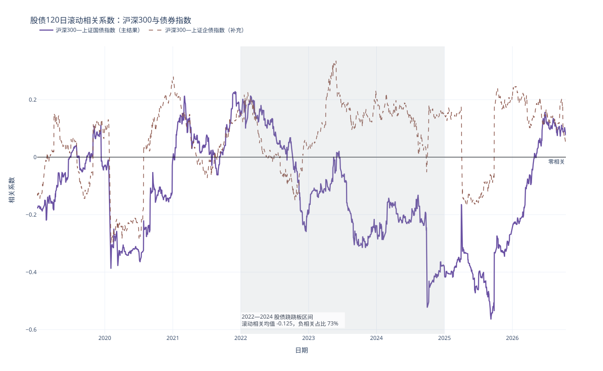
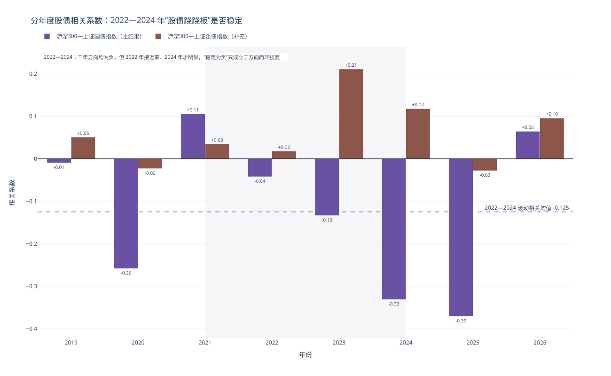
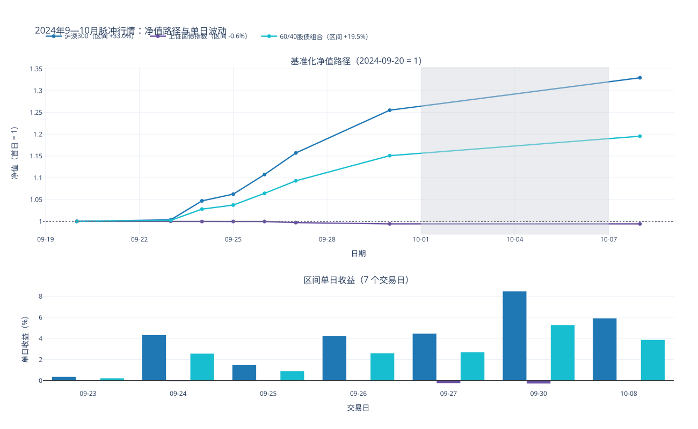

# 模块2（第3—4部分）：股债相关性与2024年脉冲行情

数据全部通过 SQL 从课程数据库 `Assignment1/data/data.duckdb` 读取，分析区间为 **2019-01-01 起至数据库最新共同交易日**。日收益率定义为 $r_t=\ln(P_t/P_{t-1})$；年化按每年 252 个交易日换算；两个资产的相关系数在共同交易日上计算，120 日滚动窗口只有在观测完整时才输出。本报告只包含模块2的第3、4部分。

## 3. 股债相关性时变

**表 3-1　股债相关性汇总（120 日滚动）**

| 资产对 | 角色 | 全样本相关 | 120日滚动期末 | 滚动最低 | 滚动最高 | 负相关观测占比 |
|:---|:---|---:|---:|---:|---:|---:|
| 沪深300—上证国债指数 | 主结果 | -0.163 | 0.077 | -0.565（2025-09-08） | 0.230（2021-12-02） | 68.2% |
| 沪深300—上证企债指数 | 补充结果 | 0.053 | 0.049 | -0.299（2020-02-05） | 0.335（2023-05-29） | 27.3% |

**表 3-2　分年度股债相关系数**

| 年份 | 共同交易日 | 沪深300—上证国债 | 沪深300—上证企债 |
|:---|---:|---:|---:|
| 2019 | 244 | -0.009 | 0.051 |
| 2020 | 243 | -0.258 | -0.023 |
| 2021 | 243 | 0.106 | 0.035 |
| 2022 | 242 | -0.042 | 0.018 |
| 2023 | 242 | -0.134 | 0.211 |
| 2024 | 242 | -0.331 | 0.118 |
| 2025 | 243 | -0.371 | -0.028 |
| 2026 | 188 | 0.065 | 0.096 |

**表 3-3　2022—2024 年 120 日滚动股债相关统计**

| 资产对 | 角色 | 滚动观测数 | 均值 | 最低 | 最高 | 负相关占比 | 低于 -0.10 占比 |
|:---|:---|---:|---:|---:|---:|---:|---:|
| 沪深300—上证国债指数 | 主结果 | 726 | -0.125 | -0.524 | 0.214 | 73.0% | 62.7% |
| 沪深300—上证企债指数 | 补充结果 | 726 | 0.106 | -0.151 | 0.335 | 14.3% | 3.2% |

**图 3-1　股债120日滚动相关系数（2022—2024 区间已标注）**

**图 3-2　分年度股债相关系数与 2022—2024 稳定性检验**

**结果说明什么：** 主结果（沪深300—上证国债指数）全样本相关系数为 -0.163，120 日滚动值的期末值为 0.077，区间内在 -0.565（2025-09-08）与 0.230（2021-12-02）之间变动，68.2% 的滚动观测为负，说明负相关是常态但绝非必然。补充结果（沪深300—上证企债指数）全样本仅 0.053，负相关占比 27.3%，明显弱于国债，说明“股债跷跷板”主要来自无风险利率与避险需求，而不是信用债。

把 2022—2024 单独看，主结果滚动相关均值为 -0.125，负相关观测占 73.0%，其中 62.7% 低于 -0.10；但区间内也曾出现 0.214（2022-02-23）的正相关与 -0.524（2024-09-30）的深度负相关，跨度达 0.738。结合分年度系数，2022 年最接近零（-0.042）、2024 年最负（-0.331），说明这三年“股债跷跷板”的特征是**方向总体为负但强度不稳定**：2022 年几乎消失、2023 年显现、2024 年才显著加深。若按 2024 年的强度外推 2022—2023 年的对冲效果，会高估债券的分散能力。

分年度看，样本末端的符号已经翻转：2025 年为 -0.371，而 2026 年至今为 0.065（仅 188 个交易日，为年内部分样本）。这说明“股债跷跷板”不是长期常数，2024—2025 年的强负相关不能直接外推为配置前提。

**对资产配置有何影响：** 60/40 组合的方差为 $\sigma_p^2=w_s^2\sigma_s^2+w_b^2\sigma_b^2+2w_sw_b\rho\sigma_s\sigma_b$。当 $\rho<0$ 时交叉项为负，债券既降波动又提供对冲；当 $\rho$ 转正（如 2026-10-16 的滚动值为 0.077），交叉项变正，60/40 的分散效果被削弱，组合波动会高于按历史负相关估计的水平。因此不能用“股债永远负相关”作为 60/40 的风险假设，配置模型应使用滚动相关或情景相关，并在相关性转正时主动下调权益敞口或引入第三个低相关资产。

## 4. 极端行情案例：2024-09-20 至 2024-10-08

**表 4-1　2024 年脉冲行情区间指标（8 个交易日，7 个日收益）**

| 对象 | 区间交易日 | 区间累计收益 | 最强单日 | 最弱单日 | 区间日波动率 | 年化波动率 | 区间最大回撤 |
|:---|---:|---:|---:|---:|---:|---:|---:|
| 沪深300 | 8 | 32.96% | +8.48%（2024-09-30） | +0.37%（2024-09-23） | 2.693% | 42.75% | 0.00% |
| 上证国债指数 | 8 | -0.57% | +0.04%（2024-09-23） | -0.29%（2024-09-30） | 0.135% | 2.15% | -0.61% |
| 60/40股债组合 | 8 | 19.55% | +5.28%（2024-09-30） | +0.24%（2024-09-23） | 1.698% | 26.95% | 0.00% |

**图 4-1　2024 年脉冲行情：基准化净值路径（上）与单日收益（下）**

**结果说明什么：** 8 个交易日内沪深300 累计上涨 32.96%，单日最大涨幅 8.48%（2024-09-30），区间日波动率 2.693%，折年 42.75%，远高于权益资产的常态波动水平。同期上证国债指数下跌 0.57%，几乎没有提供对冲。60/40 组合（首日 60% 股票 + 40% 债券，区间内不再平衡）累计上涨 19.55%，保留了股票涨幅的 59.3%，年化波动率 26.95%，比纯股票低 37.0%；组合的 7 个区间日收益没有一天为负，组合的最大回撤为 0.00%，因为行情全程单边向上。

图 4-1 下半栏逐日拆开了这 7 个交易日：沪深300 的单日涨幅介于 +0.37% 与 +8.48% 之间、日均 +4.18%；上证国债指数介于 -0.29% 与 +0.04%；60/40 组合介于 +0.24% 与 +5.28%、日均 +2.60%。收益高度集中在少数交易日：2024-09-30 一天，组合就上涨 5.28%，占整个区间累计收益 19.55% 的 27.0%。

**对资产配置有何影响：** 60/40 在这次冲击中“缓冲有效、对冲失效”：债券在权益暴涨时小幅回撤，把组合收益压到纯股票的六成，波动率同步下降约四成，说明机械式 60/40 承受住了单边行情，但它的保护来自“少亏”而不是“反向”。这提醒两点：一是 60/40 的稳健性依赖债性资产的低波动，而不是负相关，一旦债券也进入高波动阶段，缓冲会迅速变薄；二是任何基于历史波动率的风险预算在这种行情里都会严重滞后，配置规则需要预设“行情突变”情景，而不是只依赖历史波动率。

## 5. 提交文件清单

| 文件 | 内容 |
|:---|:---|
| `图3-1_股债120日滚动相关.svg/.png` | 图 3-1，120 日滚动相关系数 |
| `图3-2_分年度股债相关.svg/.png` | 图 3-2，分年度系数与稳定性检验 |
| `图4-1_2024脉冲行情_净值与单日收益.svg/.png` | 图 4-1，净值路径与单日收益 |
| `表3-1_股债相关性汇总.csv` | 表 3-1，全样本/期末/极值/负相关占比 |
| `表3-2_分年度股债相关.csv` | 表 3-2，逐年相关系数 |
| `表3-3_2022-2024滚动相关统计.csv` | 表 3-3，区间均值与负相关结构 |
| `表4-1_2024脉冲行情指标.csv` | 表 4-1，区间收益与波动指标 |
| `明细_*.csv` | 三张明细表（滚动相关序列、净值路径、逐日收益） |

## 6. 口径说明与局限

- 收益率为价格指数的对数收益，不含成分股分红；这一处理对相关系数和区间比较没有方向性影响。
- 2024-09-20 至 2024-10-08 共 8 个交易日，区间内日波动率与逐日收益基于首日之后的 7 个日收益计算，首日只作为净值基点。
- 60/40 组合在区间首日按 60% 股票、40% 债券建仓，区间内不再平衡，权重会随行情漂移。
- 滚动相关使用共同交易日样本，缺失日不填充，窗口内观测不足时不输出数值。
- 2022—2024 区间为 2022-01-01 至 2024-12-31；区间统计基于滚动序列，而表 3-2 的分年度系数基于当年日收益，两者口径不同、数值不可直接比较。
- 2026 年数据为年内部分样本，相关性的“翻转”结论只代表样本末端的状态。
