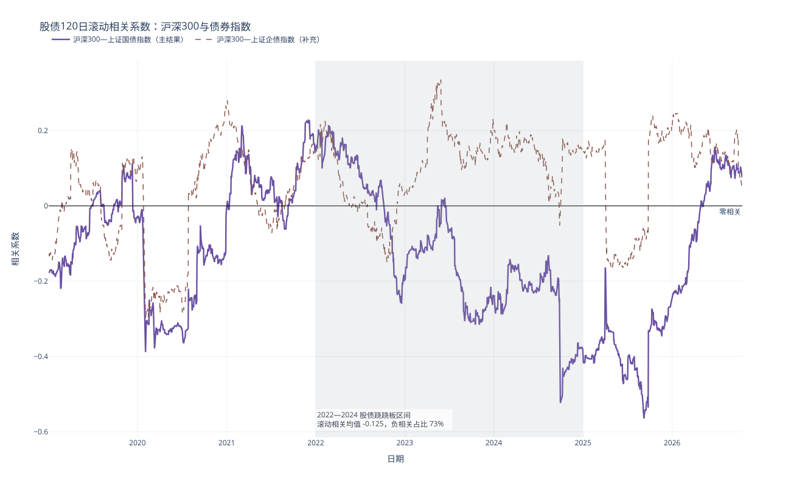
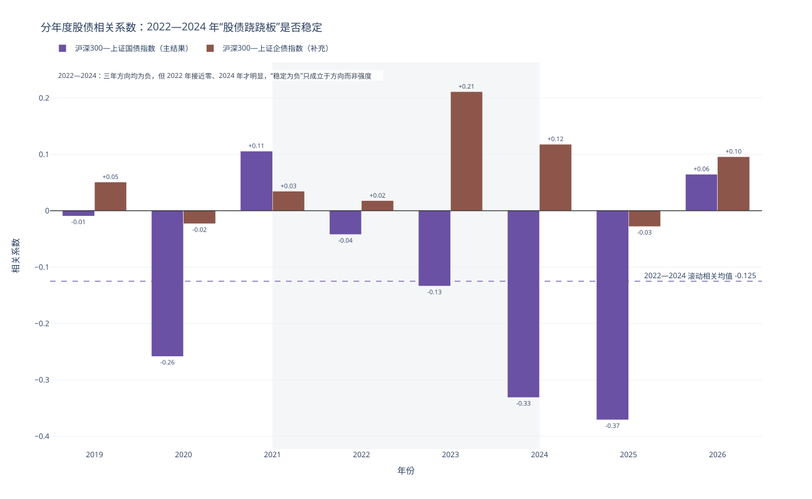
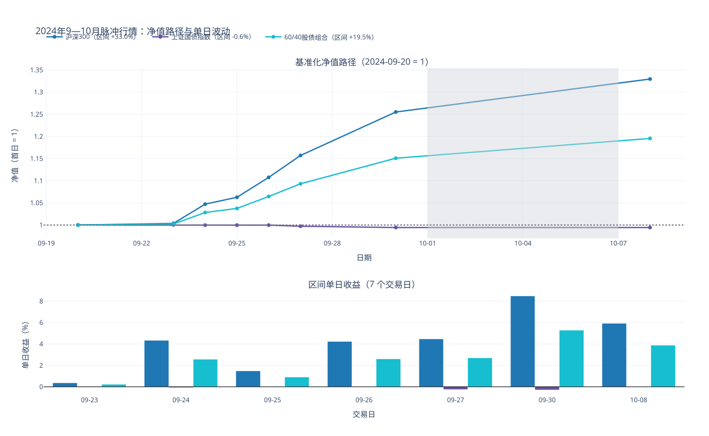
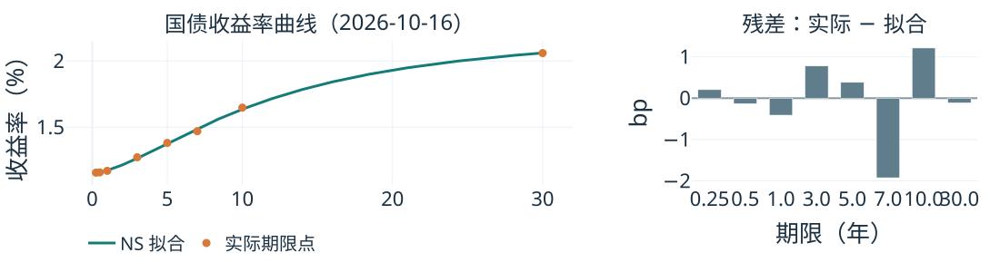

# 第一次小组作业项目报告

## 摘要

本报告面向 5 年后到期、目标稳健增值的资金，使用 2019—2026 年中国股债数据比较七类配置策略。样本内目标日期策略年化收益 6.17%、波动 9.11%、最大回撤 17.43%，三项指标均优于 60/40 的 5.00%、11.39% 和 26.30%。风险平价和滚动最小方差表现出较低风险，波动率目标策略则对调仓频率和费用较敏感。结果反映了资产选择、权重约束与市场路径的共同影响，仍需通过更丰富的资产、样本外检验和实际交易条件复核。

## 1. 研究目标与方法

项目完成了从数据入库到组合建议的完整流程：

1. 将权益指数、债券指数、国债历史收益率和最新收益率曲线清洗后写入 DuckDB；
2. 分析权益收益分布、滚动波动率、股债相关性及 2024 年脉冲行情；
3. 拟合 Nelson–Siegel 国债收益率曲线，计算久期、凸性并进行压力测试；
4. 对七类股债策略进行回测，并检验调仓频率、股票代理和交易成本。

正式分析从 2019-01-01 开始，2018 年数据只用于滚动窗口预热。日收益采用对数收益率，年化按 252 个交易日换算。跨资产计算使用共同交易日，回测信号在月末产生并于下一交易日执行。

## 2. 数据说明

### 2.1 数据来源与数据库内容

数据通过课程统一接口 `utils/findata_lib.py` 获取，获取日为 2026-10-18，最新交易日为 2026-10-16。本报告使用仓库内的 [DuckDB 数据库快照](../data/data.duckdb)，原始日频数据覆盖 2018-01-02 至 2026-10-16。数据来源、资产代码、字段定义和运行步骤见[数据说明](../data/数据说明.md)；清洗规则、缺失分布、SQL 校验和异常行情核验见[数据质量报告](../data/数据质量报告.md)。

数据库共包含以下 5 张表：

| 表名 | 内容与用途 | 记录数 | 覆盖区间 |
|---|---|---:|---|
| `assets` | 7 个资产的名称、类别、代码、来源、价格口径及适用期限段 | 7 | 资产信息，无日期字段 |
| `index_daily` | 4 个权益指数和 3 个债券类资产的日收盘点位或前复权价格，用于收益、相关性和配置回测 | 13,121 | 2018-01-02—2026-10-16；部分资产起点较晚 |
| `gov_yield_daily` | 2、5、10、30 年期国债到期收益率历史，每个期限 2,194 条，用于利率变动与债券敏感度分析 | 8,776 | 2018-01-02—2026-10-16 |
| `yield_curve_snapshot` | 0.25、0.5、1、3、5、7、10、30 年共 8 个期限点，用于 Nelson–Siegel 曲线拟合 | 8 | 标记日期为 2026-10-16，日期口径见下文 |
| `trading_calendar` | 由沪深 300 观测日期生成的交易日历，用于日期对齐与调仓信号定位 | 2,130 | 2018-01-02—2026-10-16 |

### 2.2 清洗与质量校验

清洗时统一日期和数值类型，过滤空日期、空值、非正点位、非正期限及超出 $[-5\%,20\%]$ 的国债收益率，并按主键去重、按日期排序。当前快照的清洗前后记录数一致，未发现需删除的非法或重复记录。数据库保存点位或价格及国债收益率，不直接保存资产日收益率；后者由分析模块计算。国债收益率统一采用小数口径，例如 2% 存为 `0.02`。

经数据校验和重点异常行情人工复核，表中不存在字段缺失、重复主键或非法数值。权益指数单日简单收益率绝对值超过 5% 的记录作为异常候选；2024-09-30、2024-10-08 等重点行情经相邻价格和公开市场信息核验后保留，不因涨跌幅较大而直接删除。

### 2.3 样本对齐与资产代理限制

- 权益资产包括沪深 300、中证 500、科创 50 和上证综指；债券类资产包括上证国债指数、上证企债指数及政金债 ETF 代理。主配置回测使用沪深 300 与上证国债指数，在 2019-01-02 至 2026-10-16 共有 1,887 个共同交易日。
- 科创 50 数据从 2020-01-02 开始，政金债 ETF（`511520`）从 2023-05-17 开始，均只在各自可得区间使用；政金债 ETF 仅用于短样本的长久期利率债补充比较，不参与 2019 年起的主回测。
- 缺失交易日不跨日填充，也不生成模拟值。收益基于同一资产相邻有效价格计算，跨资产分析仅使用所需序列的共同观测日期；市场日线与国债收益率历史的观测日期数量不同，不能直接按行配对。
- 权益指数、上证国债指数和上证企债指数保存指数点位，政金债代理使用前复权 ETF 价格；这些序列的价格口径和可投资性存在差异，不能直接视为同口径的可交易全收益资产。
- 最新收益率曲线接口不返回源曲线日期，数据库以历史国债收益率的最新日期 2026-10-16 代填 `curve_date`。因此，该日期是截面的数据库标记，尚未独立核实其与源曲线实际日期是否一致。

## 3. 权益市场分析

权益收益分布与波动率比较使用四个指数的共同收益样本，实际区间为 2020-01-03 至 2026-10-16，共 1,642 个日收益观测，与 2019 年起的主配置回测区间不同。四个权益指数的 Jarque–Bera 检验均在 1% 水平拒绝正态性，说明日收益具有显著厚尾。科创 50 年化波动率最高，为 33.81%；沪深 300 为 18.94%。依赖正态分布和恒定波动率的风险估计会低估尾部风险。

以下相关系数与事件指标使用 2019-01-02 至 2026-10-16 的 1,887 个共同交易日，与上一段的四指数共同样本口径不同。沪深 300 与上证国债指数的全样本相关系数为 -0.163，120 日滚动相关为负的比例为 68.2%。2022—2024 年滚动相关均值为 -0.125，负相关比例为 73.0%，但区间最大值仍达到 0.214；样本末端滚动相关转为 0.077。分年度看，相关系数由 2022 年的 -0.042、2023 年的 -0.134 加深到 2024 年的 -0.331，2026 年至今又转为 0.065，说明“股债跷跷板”在方向上成立、在强度上并不稳定。补充对照中，沪深 300 与上证企债指数全样本相关仅 0.053、负相关占比 27.3%，明显弱于国债，说明负相关主要来自无风险利率与避险需求，而非信用债。

2024-09-20 至 2024-10-08 的 8 个交易日内，沪深 300 累计上涨 32.96%，单日最大涨幅 8.48%（09-30），区间日波动率 2.693%、折年 42.75%；上证国债指数下跌 0.57%，未提供反向对冲。60/40 组合上涨 19.55%，保留股票涨幅的 59.3%，年化波动率 26.95%、比纯股票低 37.0%，7 个区间日收益全部为正。收益高度集中：09-30 单日贡献组合收益的 27.0%；由于区间内不再平衡，权益权重由 60% 漂移至 66.7%。该事件说明 60/40 的缓冲主要来自较低的债券波动，而非稳定的负相关，一旦债券也进入高波动阶段，缓冲会迅速变薄。

完整表格（表 3-1 至表 4-1）与逐日明细见[模块2 第3—4部分报告](./equity/模块2_第3-4部分_报告.md)。

## 4. 固定收益分析

**收益率曲线拟合。** 以 Nelson–Siegel 模型拟合 8 个国债期限点，五组初值分别最小化残差平方和。RMSE 为 0.877bp，最大绝对残差为 1.923bp，长期极限参数 $\beta_0=2.33\%$。

$$
y(T)=\beta_0+\beta_1\frac{1-e^{-x}}{x}
+\beta_2\left(\frac{1-e^{-x}}{x}-e^{-x}\right),
\qquad x=T/\tau,\quad \tau>0.
$$

**久期与凸性。** 用拟合收益率构造面值 100 的零息债，按年复利定价 $P=100/(1+y)^T$，计算一阶敏感度 $D_{\mathrm{mod}}=T/(1+y)$ 和二阶曲率 $C=T(T+1)/(1+y)^2$：

| 期限（年） | 拟合收益率 | 理论价格 | 修正久期（年） | 凸性 |
|---:|---:|---:|---:|---:|
| 1 | 1.1744% | 98.8392 | 0.9884 | 1.9538 |
| 3 | 1.2651% | 96.2987 | 2.9625 | 11.7020 |
| 5 | 1.3777% | 93.3874 | 4.9321 | 29.1902 |
| 10 | 1.6359% | 85.0217 | 9.8390 | 106.4875 |

**利率压力测试。** 对四个期限施加平行移动 $\pm50$、$\pm100$bp 及陡峭化冲击，与精确重定价比较下式；舍去二阶项即为仅久期近似：

$$
\frac{\Delta P}{P}\approx-D_{\mathrm{mod}}\Delta y
+\frac12 C(\Delta y)^2.
$$

10 年期在利率上、下移 100bp 时，精确收益分别为 −9.33%、+10.39%；下移情景的近似误差由 55.408bp 降至 2.164bp，体现凸性带来的涨跌不对称及精度改善。

**历史利率敏感度。** 用债券日对数收益回归 10 年国债收益率变化：$r_t=\alpha+\beta\Delta y_t^{10Y}+\varepsilon_t$。采用 OLS、Newey–West 标准误（滞后 5 阶）及 252 日滚动估计。国债指数和政金债 ETF 系数显著为负，企债不显著；$-\beta$ 为经验敏感度，不等同于现金流久期。

**2024 年末案例。** 以 11 月 1 日为基期计算截至 12 月 31 日的价格收益。10 年国债收益率下降 46.54bp，政金债 ETF、国债指数和企债指数分别上涨 3.83%、2.28%、0.76%。将该利率变化代入固定剩余期限的 10 年零息债，凸性修正把误差从 11.63bp 降至 0.21bp；此项检验未计入票息与期限缩短。

[完整方法与结果](./fixed_income/模块3_固定收益分析报告.md)

## 5. 配置方案与回测结果

### 5.1 回测设定与策略绩效

回测在沪深 300 与上证国债指数之间配置，比较七类策略。月末收盘后确定目标权重，下一交易日收盘调仓；月内权重自然漂移，默认单边交易成本为 10bp，均不使用杠杆。具体规则与样本内绩效如下：

| 策略 | 年化收益 | 年化波动 | Sharpe | 最大回撤 | 配置规则 |
|---|---:|---:|---:|---:|---|
| 全股 | 4.64% | 19.06% | 0.244 | 45.60% | 始终持有 100% 沪深 300 |
| 全债 | 4.21% | 0.72% | 5.889 | 1.02% | 始终持有 100% 上证国债指数 |
| 60/40 | 5.00% | 11.39% | 0.439 | 26.30% | 每月恢复至 60% 股票、40% 债券 |
| 风险平价 | 4.41% | 0.91% | 4.868 | 0.77% | 按过去 60 日股债波动率的倒数配权 |
| 滚动最小方差 | 4.65% | 3.76% | 1.237 | 4.30% | 用 120 日协方差最小化方差，股票权重限于 20%—80% |
| 波动率目标 | 5.18% | 10.10% | 0.514 | 26.50% | 以 60/40 为基础，60 日估计波动率超过 10% 时缩减股票仓位 |
| 目标日期 | 6.17% | 9.11% | 0.677 | 17.43% | 股票目标权重在前 1,260 个交易日由 70% 降至 30%，之后维持 30% |

目标日期策略取得最高年化收益，风险平价取得最低最大回撤，全债的 Sharpe 最高。不同指标对应不同的风险暴露和评价口径，进一步讨论见下节。

[查看七类策略净值对比](../figures/module4/nav_comparison.html) · [查看回撤对比](../figures/module4/drawdown_comparison.html)

<!-- allocation-metric-notes -->
数值注 1：全债 Sharpe 5.889、风险平价 Sharpe 4.868 来自较低的价格指数波动。本报告使用几何年化收益除以对数收益年化波动率、无风险利率取 0；全债年化收益 4.21%、波动约 0.72%，因此比率很高。该口径不同于常见的日超额收益 Sharpe。

数值注 2：波动率目标的实际年化波动为 10.10%，最大回撤 26.50% 略高于 60/40 的 26.30%。10% 是基于历史窗口的风险预算，不是对未来波动或回撤的硬约束；月度更新、下一交易日收盘执行及只缩减股票敞口的实现，均会使实际风险偏离目标。
<!-- /allocation-metric-notes -->

## 6. 稳健性检验

按参数、资产替换、信号日期、调仓频率和交易成本五种方法比较。除成本检验外，均沿用单边 10bp、无杠杆和下一交易日收盘执行。参数、频率与成本检验统一使用2019-01-02—2026-10-16 的 1,887 个价格交易日，2018 年用于预热。各情景共享样本及部分默认对照，不构成独立样本外验证。

### 6.1 参数敏感性

九组、28 个情景逐项改变参数，其余保持默认。下表为各指标的最小—最大值，各列极值不一定对应同一档参数；不根据这些结果回选默认参数。

| 改变参数 | 试验档位 | 年化收益范围 | Sharpe 范围 | 最大回撤范围 |
| --- | --- | --- | --- | --- |
| 固定配置股票权重 | 50% / 60% / 70% | 4.97%—5.00% | 0.374—0.525 | 20.75%—31.51% |
| 风险平价窗口 | 30日 / 60日 / 120日 | 4.41%—4.47% | 4.868—4.980 | 0.77%—0.88% |
| 最小方差窗口 | 60日 / 120日 / 240日 | 4.65%—4.65% | 1.237—1.237 | 4.30%—4.30% |
| 最小方差股票下限 | 0% / 10% / 20% / 30% | 4.35%—4.81% | 0.849—6.296 | 0.96%—9.07% |
| 波动率目标窗口 | 30日 / 60日 / 120日 | 4.59%—5.71% | 0.464—0.570 | 23.73%—26.50% |
| 目标年化波动率 | 8% / 10% / 12% | 5.04%—5.18% | 0.470—0.575 | 23.50%—26.89% |
| 目标日期起始股票权重 | 60% / 70% / 80% | 5.85%—6.48% | 0.645—0.713 | 15.41%—19.42% |
| 目标日期终点股票权重 | 20% / 30% / 40% | 5.91%—6.41% | 0.587—0.774 | 14.65%—20.53% |
| 目标日期滑降期限 | 1008日 / 1260日 / 1512日 | 5.93%—6.45% | 0.623—0.745 | 14.65%—19.24% |

数值注：三个最小方差窗口的 94 个生效信号均取 20% 股票下限，故绩效几乎相同。下限为 0% 时波动仅约 0.69%，放大了 Sharpe（6.296），并不意味着收益更高。

最小方差对窗口不敏感，但股票下限从 0% 升至 30% 时，回撤由 0.96% 升至 9.07%。波动率目标的 30 日、120 日窗口年化收益为 5.71%、4.59%，参数依赖更明显。目标日期邻近参数下收益为 5.85%—6.48%，均高于默认 60/40 的 5.00%。

### 6.2 资产替换检验

#### 6.2.1 资产替换检验：长样本

沪深 300、中证 500、上证综指 × 国债、企债指数，六组资产对均运行七类策略（42 个情景）。共同区间为 2019-01-02—2026-10-16，共 1,887 个价格交易日。

| 策略 | 年化收益范围 | Sharpe 范围 | 最大回撤范围 |
| --- | --- | --- | --- |
| 全股 | 4.64%—6.83% | 0.244—0.337 | 27.27%—45.60% |
| 全债 | 4.21%—4.34% | 5.889—16.825 | 0.11%—1.02% |
| 60/40 | 5.00%—6.66% | 0.439—0.546 | 13.74%—26.48% |
| 风险平价 | 4.40%—4.44% | 4.850—11.418 | 0.18%—0.79% |
| 最小方差 | 4.65%—5.39% | 1.186—1.440 | 3.35%—5.36% |
| 波动率目标 | 5.18%—7.07% | 0.511—0.655 | 14.28%—26.65% |
| 目标日期 | 5.82%—7.20% | 0.671—0.727 | 10.39%—17.83% |

数值注：全债 Sharpe 16.825 对应企债指数的 4.34% 收益与约 0.258% 波动，主要由小分母放大，实际产品风险仍需另行核验。

目标日期在六组中年化收益均居七类策略首位；60/40 的回撤则随资产对变化至 13.74%—26.48%。

#### 6.2.2 资产替换检验：短样本

加入科创 50、政金债 ETF 后，十二组资产对均运行七类策略（84 个情景）。统一使用 2024-01-02—2026-10-16 的 673 个价格交易日，并从 2023-05-17 预热；目标日期从 2024 年起滑降，尚未覆盖完整五年。

| 策略 | 年化收益范围 | Sharpe 范围 | 最大回撤范围 |
| --- | --- | --- | --- |
| 全股 | 8.12%—19.77% | 0.339—0.534 | 14.73%—38.46% |
| 全债 | 3.98%—5.08% | 2.128—19.714 | 0.02%—2.60% |
| 60/40 | 7.06%—17.12% | 0.524—0.799 | 7.98%—23.94% |
| 风险平价 | 4.07%—7.93% | 2.309—12.803 | 0.08%—1.86% |
| 最小方差 | 5.21%—10.12% | 1.113—1.793 | 1.74%—7.84% |
| 波动率目标 | 7.74%—18.28% | 0.828—1.363 | 7.98%—10.76% |
| 目标日期 | 7.67%—17.20% | 0.542—0.811 | 8.81%—20.23% |

数值注：企债全债收益 3.98%、波动约 0.202%，Sharpe 达 19.714；回撤仅 0.0240%（表中 0.02%），使 Calmar 达 165.455。这些比率按当前价格序列复算一致，经济含义仍需可交易全收益品种验证。

五种配置策略中，波动率目标在十二组中均取得最高年化收益；若包括全股、全债，则波动率目标与全股各领先六组。区间和滑降起点同时改变，不能把排名变化单独归因于资产替换。

### 6.3 信号日期检验

月中取每月 15 日或之前最近共同交易日，月末取最后交易日，均于下一交易日收盘执行。两组统一截至 2026-09-30，共 1,880 个价格交易日，各 93 个执行时点。全股、全债结果相同，下表列五种配置策略。

| 策略 | 年化收益（月末→月中） | Sharpe（月末→月中） | 最大回撤（月末→月中） |
| --- | --- | --- | --- |
| 60/40 | 5.37%→5.21% | 0.471→0.455 | 26.30%→26.31% |
| 风险平价 | 4.40%→4.36% | 4.855→4.728 | 0.77%→0.81% |
| 最小方差 | 4.77%→4.65% | 1.265→1.224 | 4.30%→4.30% |
| 波动率目标 | 5.48%→5.00% | 0.542→0.493 | 26.50%→26.41% |
| 目标日期 | 6.35%→6.20% | 0.696→0.678 | 17.43%→17.35% |

口径注：本表截止日期较早，月末收益与主回测不同；例如波动率目标为 5.48% 而非 5.18%，应在同一日期区间内比较。

月中信号下，波动率目标年化收益少 47.8bp，目标日期少 15.0bp，其他三种策略少 4.1—16.4bp；这不能证明月末在其他样本中仍占优。

### 6.4 调仓频率检验

五种配置策略分别按月末、季末信号调仓，共 10 个情景，分别有 94、32 个执行时点。目标日期保持相同的 2019 年起点及 1,260 个交易日滑降期限。

| 策略 | 年化收益（月度→季度） | Sharpe（月度→季度） | 最大回撤（月度→季度） |
| --- | --- | --- | --- |
| 60/40 | 5.00%→5.06% | 0.439→0.445 | 26.30%→26.16% |
| 风险平价 | 4.41%→4.33% | 4.868→4.773 | 0.77%→0.89% |
| 最小方差 | 4.65%→4.70% | 1.237→1.251 | 4.30%→4.21% |
| 波动率目标 | 5.18%→4.27% | 0.514→0.421 | 26.50%→24.90% |
| 目标日期 | 6.17%→6.23% | 0.677→0.679 | 17.43%→17.45% |

目标日期收益、Sharpe 和回撤变化较小，对月度／季度相对稳定。波动率目标改为季度后收益降低，回撤也减小，体现不同指标之间的取舍；两种频率共用 1,260 个交易日的滑降路径。

### 6.5 交易成本检验

五种配置策略均比较单边 0、10、30bp 成本，共 15 个配置情景；调仓按双边换手金额扣费。表中完整列出三档年化收益，损耗均相对零成本计算；逐档风险指标见模块报告与 HTML 展开表。

| 策略 | 0bp | 10bp | 30bp | 30bp 年化收益损耗 |
| --- | --- | --- | --- | --- |
| 60/40 | 5.03% | 5.00% | 4.94% | 8.4bp |
| 风险平价 | 4.42% | 4.41% | 4.37% | 5.5bp |
| 最小方差 | 4.67% | 4.65% | 4.62% | 5.6bp |
| 波动率目标 | 5.30% | 5.18% | 4.95% | 35.8bp |
| 目标日期 | 6.20% | 6.17% | 6.11% | 8.3bp |

口径注：8.4bp 损耗约为 0.084 个百分点，按未四舍五入收益计算。全股、全债无再平衡换手，三档结果相同；未计初始建仓及持有费用。

数值注：费用提高可能使统计波动略降，波动率目标为 10.102%→10.083%；其 Sharpe 同时从 0.525 降至 0.490、回撤从 26.30% 升至 26.88%，并非风险改善。

波动率目标损耗 35.8bp，其他四种为 5.5—8.4bp；在 30bp 下，其年化收益 4.95% 已接近 60/40 的 4.94%。

完整逐档成本指标及回测结果见[模块四分析报告](asset_allocation/模块4_分析报告.md#四稳健性检验)。

## 7. 讨论与局限性

### 7.1 研究局限

**资产与策略空间有限。** 主回测只有一个股票指数和一个债券指数，在不做空、不加杠杆的约束下，各策略主要调整一个股票权重。缺少更多权益风格、债券期限和其他资产，限制了跨资产风险分散、对冲及更复杂组合策略的实现，也限制了探索更高风险调整收益的途径。增加资产或模型复杂度本身并不保证 Sharpe 提高，仍需检验新增资产是否提供稳定的分散效果及可实现收益。

**稳健性证据仍有边界。** 参数敏感性、资产替换、信号日期、调仓频率和交易成本检验反映既定样本内的设定依赖，尚未提供独立样本外证据或多个完整五年投资周期；邻近参数、共享资产及重叠交易日也不构成独立样本。目标日期对月度／季度调仓相对稳定，但长短样本的排名差异说明其优势仍可能依赖市场阶段。Sharpe 采用几何年化收益除以对数收益年化波动率、无风险利率设为 0，低波动债券策略的高比率需要结合该口径理解。

**交易模拟与实际操作有差距。** 回测按下一交易日收盘价完成调仓，以固定费率计提成本，未模拟初始建仓成本、买卖价差、冲击成本、流动性约束及成交失败。实际投资还需使用可交易产品，承担跟踪误差、申赎和费用差异。尤其对持续调整股票敞口的波动率目标策略，历史信号的可用性、成交时点和真实成本可能共同改变净值路径。

### 7.2 策略表现与稳健性讨论

**固定滑降路径取得最高收益。** 目标日期年化收益 6.17%，高于全股的 4.64%，同时回撤更低。其权重由预设时间表决定，这一表现可能与较高股票仓位遇到前段上涨、随后降仓遇到后段调整的市场顺序有关。还应注意，滑降只持续前 1,260 个交易日，之后维持 30% 股票目标；2019—2026 年的整体结果包含滑降完成后的尾段，并非多个独立五年投资周期的验证。

**风险平价的回撤低于全债。** 风险平价最大回撤仅 0.77%，低于全债的 1.02%，Sharpe 达到 4.868，但年化收益为 4.41%。债券波动显著低于股票，倒数波动率配权使组合长期偏向债券；少量股票在本次路径中进一步平滑了部分回撤。其高 Sharpe 首先反映低波动分母和当前指标口径，仍需用可交易资产及统一的超额收益口径复核。

**最小方差的低风险高度依赖仓位下限。** 将协方差窗口由 60 日改为 240 日，绩效几乎完全相同；将股票下限从 0% 改为 30%，回撤却从 0.96% 升至 9.07%。原设定下平均股票权重约 19.96%，低风险主要与仓位边界有关，窗口不敏感不能直接视为估计质量的证据。后续仍可加入固定 20/80 对照，单独衡量滚动协方差相对固定低股票比例的贡献。

**降低波动率仍可能经历更深回撤。** 波动率目标把年化波动率从 60/40 的 11.39% 降至 10.10%，最大回撤却由 26.30% 略升至 26.50%。参数与信号日期检验中，窗口与信号日期也改变了收益表现，而短样本中该策略反而在全部十二组的五种股债配置策略间领先。波动率、回撤与收益刻画不同目标，单一历史排名不足以替代对参数和市场阶段的讨论。

## 8. 小组分工与 AI 工具使用声明

### 8.1 小组成员与分工

仓库现有记录不足以可靠确定四位成员与全部模块的对应关系。提交前请按实际贡献确认下表，避免误署名。

| 成员 | 学院与年级 | 负责内容 |
|---|---|---|
| 李彦臻 | 数学科学学院 2023 级 | 待小组确认 |
| 毛志远 | 数学科学学院 2024 级 | 数据工程，固定收益分析，股债配置 |
| 霍彬然 | 数学科学学院 2024 级 | 固定收益分析，配置方案，回测 |
| 李俊涛 | 数学科学学院 2024 级 | 权益分析（模块2 第 3—4 部分） |

### 8.2 AI 工具使用声明

项目使用 ChatGPT/Codex 辅助代码审查、文档结构整理、Markdown 与 HTML 排版、路径检查和测试建议。数据获取、金融公式、统计计算和回测结果均由仓库代码生成，并由小组成员结合 CSV、图表和原始输出进行核对。AI 工具未用于生成虚构数据或替代小组对研究结论的最终判断。

## 9. 成果索引

- [数据说明](../data/数据说明.md)
- [数据质量报告](../data/数据质量报告.md)
- [权益分析第1—2部分](./equity/模块2_第1-2部分_报告.md)
- [权益分析第3—4部分](./equity/模块2_第3-4部分_报告.md)
- [固定收益分析报告](./fixed_income/模块3_固定收益分析报告.md)
- [股债配置分析报告](./asset_allocation/模块4_分析报告.md)
- [交互式项目展示](./项目展示.html)
