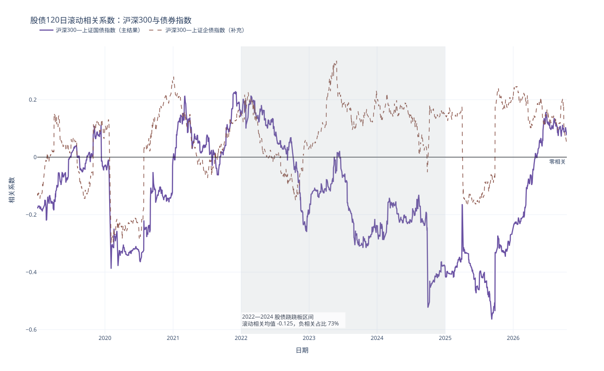
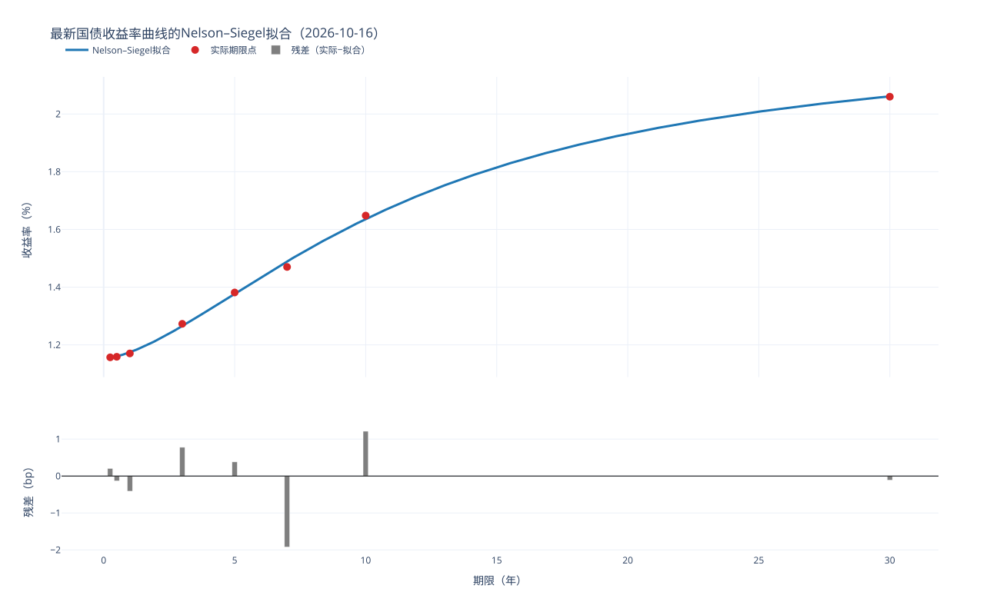

# 第一次小组作业项目报告

## 摘要

本报告面向 5 年后到期、目标稳健增值的资金，使用 2019—2026 年中国股债数据检验配置方案。样本内目标日期策略年化收益 6.17%、波动 9.11%、最大回撤 17.43%，优于 60/40 的 5.00%、11.39% 和 26.30%，因此作为主方案。该结论依赖特定市场路径，实际应用仍需样本外验证、成本控制和风险限额。

## 1. 研究目标与方法

项目完成了从数据入库到组合建议的完整流程：

1. 将权益指数、债券指数、国债历史收益率和最新收益率曲线清洗后写入 DuckDB；
2. 分析权益收益分布、滚动波动率、股债相关性及 2024 年脉冲行情；
3. 拟合 Nelson–Siegel 国债收益率曲线，计算久期、凸性并进行压力测试；
4. 对七类股债策略进行无前视回测，并检验调仓频率、股票代理和交易成本。

正式分析从 2019-01-01 开始，2018 年数据只用于滚动窗口预热。日收益采用对数收益率，年化按 252 个交易日换算。跨资产计算使用共同交易日，回测信号在月末产生并于下一交易日执行。

## 2. 数据说明

数据来自课程统一接口，经清洗后保存于 `Assignment1/data/data.duckdb`。数据库包含 7 个资产、13,121 条市场日线、8,776 条国债历史收益率和 8 个最新曲线期限点。核心股债序列在 2019-01-02 至 2026-10-16 共有 1,887 个共同交易日。

自动校验共 13 项，其中 12 项通过，1 项警告来自科创 50 和政金债 ETF 的较晚上市时间。事实表不存在缺失值、重复主键或非法数值。2024-09-30、2024-10-08 等超过 5% 的权益涨跌经相邻价格和公开市场信息核验后保留。

主要口径与代理限制如下：

- 上证国债指数作为配置回测的债券资产；
- 政金债 ETF 仅用于短样本的长久期利率债比较；
- 上证国债和企债使用指数点位，政金债使用前复权 ETF 价格；
- 最新收益率曲线以 2026-10-16 作为截面日期。

## 3. 权益市场分析

四个权益指数的 Jarque–Bera 检验均在 1% 水平拒绝正态性，说明日收益具有显著厚尾。科创 50 年化波动率最高，为 33.81%；沪深 300 为 18.94%。依赖正态分布和恒定波动率的风险估计会低估尾部风险。

沪深 300 与上证国债指数的全样本相关系数为 -0.163，120 日滚动相关为负的比例为 68.2%。2022—2024 年滚动相关均值为 -0.125，负相关比例为 73.0%，但区间最大值仍达到 0.214；样本末端滚动相关转为 0.077。股债负相关较常见，但强度和方向都会变化，不能把“股债跷跷板”视为固定规律。

2024-09-20 至 2024-10-08，沪深 300 累计上涨 32.96%，上证国债指数下跌 0.57%，未提供反向对冲。60/40 组合上涨 19.55%，但折算年化波动率仍达到 26.95%。该事件说明 60/40 的缓冲主要来自较低的债券波动，而非稳定的负相关。

## 4. 固定收益分析

使用 2026-10-16 的 8 个国债期限点进行 Nelson–Siegel 多初值拟合，5 组初值收敛到同一组参数，RMSE 为 0.877bp，最大绝对残差为 1.923bp。长期利率参数 $\beta_0=2.33\%$，曲线呈短端低于长端的形态。

期限越长，利率敏感度越高。10 年期零息债修正久期为 9.839，凸性为 106.49。在 100bp 平行下移情景中，仅用久期近似的误差为 55.408bp，加入凸性后降至 2.164bp，说明长久期或大幅利率冲击下必须考虑凸性。

利率敏感度回归显示，上证国债指数隐含久期为 0.91 年，政金债 ETF 为 6.16 年；上证企债指数的利率系数不显著，$p=0.93$，信用利差等因素对企债更重要。2024 年末 10 年期国债收益率下降 46.54bp，政金债 ETF、上证国债指数和企债指数分别上涨 3.83%、2.28% 和 0.76%。在该真实行情中，凸性修正把 10 年期零息债的估值误差从 11.63bp 降至 0.21bp。

## 5. 配置方案与回测结果

回测比较全股、全债、固定 60/40、风险平价、滚动最小方差、波动率目标和目标日期七类策略。所有策略允许月内权重自然漂移，默认单边交易成本为 10bp。

| 策略 | 年化收益 | 年化波动 | Sharpe | 最大回撤 | 主要特征 |
|---|---:|---:|---:|---:|---|
| 全股 | 4.64% | 19.06% | 0.244 | 45.60% | 收益弹性高，回撤最大 |
| 全债 | 4.21% | 0.72% | 5.889 | 1.02% | 低波动价格指数基准 |
| 60/40 | 5.00% | 11.39% | 0.439 | 26.30% | 简单透明，但回撤仍高 |
| 风险平价 | 4.41% | 0.91% | 4.868 | 0.77% | 无杠杆下高度集中于债券 |
| 滚动最小方差 | 4.65% | 3.76% | 1.237 | 4.30% | 股票权重下限约束经常生效 |
| 波动率目标 | 5.18% | 10.10% | 0.514 | 26.50% | 收益改善，但未降低最大回撤 |
| 目标日期 | 6.17% | 9.11% | 0.677 | 17.43% | 样本内收益与回撤平衡最好 |

目标日期策略从 70% 股票线性下降至 30%，与 5 年到期资金的风险承受能力变化相匹配。样本内其年化收益最高，波动率和回撤均低于 60/40，因此作为主方案。滚动最小方差可以作为更保守的对照方案，但其较低风险主要来自接近 20% 的股票配置。

稳健性结果显示：

- 60/40 从月度改为季度调仓后指标变化较小；
- 将股票代理从沪深 300 换为上证综指后，60/40 最大回撤由 26.30% 降至 13.74%，说明结论对股票基准敏感；
- 波动率目标策略季度调仓的年化收益从 5.18% 降至 4.27%，对调仓频率较敏感；
- 单边成本提高至 30bp 后，目标日期策略年化收益仅损失约 8.3bp，而波动率目标策略损失约 35.8bp。

[查看七类策略净值对比](../figures/module4/nav_comparison.html) · [查看回撤对比](../figures/module4/drawdown_comparison.html)

## 6. 配置建议

对于 5 年后到期、目标稳健增值的资金，建议以目标日期策略作为主方案，并保留以下约束：

- 股票目标权重从 70% 平滑降至 30%，按月检查并在下一交易日调仓；
- 监控股债滚动相关和组合波动率，避免把历史负相关当作长期常数；
- 保留交易成本和最大回撤预算，不因样本内表现使用杠杆；
- 将 60/40 作为简单基准，将滚动最小方差作为低风险参照，而非直接替代主方案。

## 7. 局限性与诚实讨论

### 7.1 样本与市场状态

回测仅覆盖 2019—2026 年，无法代表完整利率周期和长期权益风险溢价。目标日期策略在样本早期保持高股票仓位、后期逐步降仓，恰好与样本中的市场路径较为匹配；这可能是其表现领先的重要原因。若未来市场顺序相反，该滑降路径未必继续占优。

### 7.2 资产代理与可投资性

上证国债指数和上证企债指数属于指数点位，不等同于可直接交易的全收益产品。价格指数可能没有完整反映票息、分红、税费和实际跟踪误差。政金债 ETF 样本从 2023 年开始，只能作为补充检验。科创 50 也从 2020 年开始，跨指数比较使用了更短的共同样本。

### 7.3 模型与参数风险

风险平价在无杠杆条件下因债券波动率过低而退化为类固收组合。滚动最小方差的结果明显受 20% 股票权重下限影响。波动率目标策略依赖 60 日窗口和 10% 目标，且月度信号无法提前规避突发下跌。不同窗口、边界和目标值可能改变排序，当前结果没有经过独立样本选择参数。

### 7.4 交易与回测假设

回测假设月末收盘后产生信号并在下一交易日按可观测价格完成调仓。实际交易还会受到买卖价差、冲击成本、申赎限制和成交时点影响。固定 10bp 成本无法覆盖所有市场状态，尤其可能低估高换手策略在压力时期的成本。Sharpe 计算采用 0 无风险利率，也会抬高低波动债券策略的比率。

### 7.5 固收模型简化

久期与压力测试采用零息债和年复利近似，没有完整刻画票息、现金流再投资和债券指数成分调整。压力情景主要是平行移动和简单陡峭化，未覆盖曲线扭转、信用利差冲击和流动性冲击。企债回归只使用 10 年国债收益率一个因子，无法识别信用风险来源。

### 7.6 样本外与策略选择偏差

项目在同一数据窗口上比较了七类策略，存在多重比较和样本内选择偏差。当前报告没有设置独立训练期、验证期或滚动样本外检验，也没有对策略绩效差异进行统计显著性检验。因此，样本内最优不等于未来最优，实际决策应进行走步回测、情景模拟和参数敏感性分析。

## 8. 小组分工与 AI 工具使用声明

### 8.1 小组成员与分工

仓库现有记录不足以可靠确定四位成员与全部模块的对应关系。提交前请按实际贡献确认下表，避免误署名。

| 成员 | 学院与年级 | 负责内容 |
|---|---|---|
| 李彦臻 | 数学科学学院 2023 级 | 待小组确认 |
| 毛志远 | 数学科学学院 2024 级 | 待小组确认 |
| 霍彬然 | 数学科学学院 2024 级 | 待小组确认 |
| 李俊涛 | 数学科学学院 2024 级 | 待小组确认 |

### 8.2 AI 工具使用声明

项目使用 ChatGPT/Codex 辅助代码审查、文档结构整理、Markdown 与 HTML 排版、路径检查和测试建议。数据获取、金融公式、统计计算和回测结果均由仓库代码生成，并由小组成员结合 CSV、图表和原始输出进行核对。AI 工具未用于生成虚构数据或替代小组对研究结论的最终判断。

## 9. 成果索引

- [数据质量报告](../data/数据质量报告.md)
- [权益分析第1—2部分](./equity/模块2_第1-2部分_报告.md)
- [权益分析第3—4部分](./equity/模块2_第3-4部分_报告.md)
- [固定收益分析报告](./fixed_income/模块3_固定收益分析报告.md)
- [股债配置分析报告](./asset_allocation/模块4_分析报告.md)
- [交互式项目展示](./项目展示.html)
